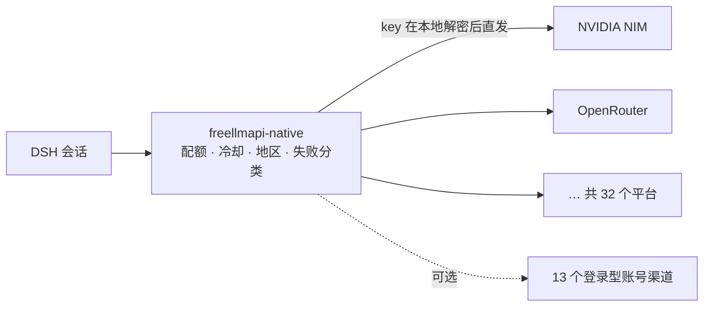

<div align="center">


# dsh-freellmapi

**在 DeepSeek Harness 进程内直接调度各家的免费模型。**
297 个模型 · 32 个平台 · 按配额选路 · 自动故障转移 · 无外部网关

[](LICENSE)
[](#环境要求)
[](#安装)
[](#开发)

</div>

> **English**: a DeepSeek Harness plugin that routes model calls across free-tier
> providers **in-process** — no gateway, no extra port, no Docker, keys never
> leave your machine. Overview in [English below](#english).

---

## 为什么是"进程内"

绝大多数"免费模型聚合"方案需要你先跑一个网关（LiteLLM / one-api / 自建代理），
插件再指向 `http://localhost:xxxx`。代价是多一个常驻进程、多一跳网络、多一个存
放所有 key 的地方。

这个插件把这些都省掉：路由逻辑注册成 DSH 的一条 provider 路由
（`freellmapi-native`），请求由 **DSH 进程自己**直接发往上游。



## 功能

| 能力 | 说明 |
|---|---|
| **模型目录** | 内置 `src/native/catalog.json`：297 个模型 ID、342 条可用路由、32 个可拨号平台、194 条支持工具调用。目录随包发布，选模型不需要联网 |
| **配额感知选路** | 按平台的配额类型（credits / 每模型限额）记账，key 进入冷却后跳过，冷却结束自动恢复，无需手动干预 |
| **自动故障转移** | 失败按语义分类处理：401/403 换 key、429 冷却后换平台、5xx 重试、400 直接停（不会把时间浪费在注定失败的模型上） |
| **地区探测** | 主动向已配置平台发一个最小请求，标记**从本机不可达**的模型/平台组合，之后路由直接跳过它们，而不是每次真实请求去撞墙 |
| **思考强度翻译** | 把统一的推理档位翻译成各家自己的参数（`reasoning_effort` / thinking 开关），一套配置适配所有上游 |
| **空响应恢复** | 模型把整个输出额度花在思考上、正文为空时，自动追问一次要答案（可关，见 `recovery`） |
| **命名链 `combo:`** | 把多个模型串成一条可寻址的链，`strategy` 支持 `fallback`（固定顺序）与 `round-robin`（按轮换起点摊平负载），`stickyRounds` 控制一个模型粘几轮 |
| **工具能力记忆** | 记录哪些模型在工具调用上可靠；带 tools 的请求优先给它们，避免反复撞上"能聊天但不会用工具"的中转 |
| **账号渠道（可选）** | 支持 13 个"登录即可用"的渠道；渠道包需自行放入，不随本仓库分发（见 [账号渠道](#账号渠道可选不随本仓库分发)） |
| **设置面板** | 概览 / 模型 / 密钥 / 链 / 工具 / 健康 / 渠道 七个页签，显示用量、冷却、可达性 |
| **密钥本地封存** | AES-256-GCM 加密后落盘，主密钥单独一个文件，明文 key 不落任何配置 |

## 环境要求

- **DeepSeek Harness**：插件依赖 `llm` 服务；设置面板额外需要 `webServer`（缺失时路由照常工作，只是没有面板）
- **Node.js** `^22.19.0 || >=24.0.0`

## 安装

> 本包**未发布到 npm**（`package.json` 里 `"private": true`），请从 git 或本地目录安装。

**1) 从 GitHub 装进 profile**

```bash
cd <你的 DSH profile 目录>
pnpm add github:duncanpanic/dsh-freellmapi
```

或让插件管理器安装这个 spec：`github:duncanpanic/dsh-freellmapi`。

**2) 从本地目录装**（开发时用）

```bash
pnpm add /绝对路径/dsh-freellmapi
```

**3) 手动挂载**：把 `cordis.patch.yml` 里那一行 `insert` 复制到你 profile 的 patch 里。

装好后在设置面板里添加至少一个平台的 key 即可使用；没有 key 时 provider 会注册但不返回任何候选。

## 配置

配置写在 profile 的 `cordis.patch.yml` 里，字段全部可省略——省略即用默认值。
旧版把字段嵌套在 `native:` 下的写法仍然兼容（扁平字段优先）。

| 键 | 默认 | 说明 |
|---|---|---|
| `enabled` | `true` | `false` = 完全不注册 provider |
| `displayName` | `FreeLLMAPI` | 模型选择器里显示的名字 |
| `dataDir` | `~/.dsh/freellmapi` | 密钥、用量、退役记录的存放目录；留空即默认值 |
| `timeoutMs` | `120000` | 单次上游请求超时（毫秒） |
| `recovery.enabled` | `true` | 空响应时是否追问一次 |
| `recovery.totalTimeoutMs` | `1800000` | 首次请求 + 追问的总时长上限（只能调小，不能超过默认值） |
| `recovery.maxOutputTokens` | `8192` | 追问时给的输出预算（同样只能调小） |
| `chains[]` | `[]` | 命名链，见下 |
| `chains[].name` | — | 链名，最终暴露为 `combo:<name>`；不能以 `combo:` 开头 |
| `chains[].steps` | — | 有序的模型 ID 列表，`auto` 可以作为最后一步 |
| `chains[].strategy` | `fallback` | `fallback` 固定从第 1 步开始；`round-robin` 轮换起点 |
| `chains[].stickyRounds` | `1` | `round-robin` 下每个起点粘几轮（上限 50） |
| `channels.enabled` | `true` | 是否挂载账号渠道包 |
| `channels.enableOpencode` | `false` | 单独放行 OpenCode 渠道（与上游默认一致，关） |

`round-robin` 的轮换单位是**步**，不是路由：一步里配了两个平台仍然是一步，不会把一步拆开。

```yaml
- id: freellmapi
  name: dsh-freellmapi
  config:
    enabled: true
    displayName: FreeLLMAPI
    timeoutMs: 120000
    recovery:
      enabled: true
    chains:
      - name: coding
        steps: [qwen3-coder, nemotron-3-ultra, auto]
        strategy: fallback
      - name: spread
        steps: [qwen3.5-9b, llama-3.3-70b]
        strategy: round-robin
        stickyRounds: 3
    channels:
      enabled: true
```

## 使用

1. 在 **设置 → 插件 → FreeLLMAPI** 打开面板，在「密钥」页签按平台粘贴 key；
2. 回到模型选择器，选 `FreeLLMAPI` 这个 provider，模型列表来自内置目录；
3. 直接用模型 ID，或用链：`combo:coding`。

模型 ID 就是目录里的裸名字（如 `qwen/qwen3.8-max:free`、`gemini-3.8-flash`）。
客户端如果发 `平台/模型` 的写法，也会按最后一段自动匹配。

**`auto`** 是唯一的虚拟路由：把所有可用模型按 *intelligence 排名 → 速度 → 上下文长度*
排序后依次尝试（排名数字越小越好）。`fusion` 在目录里被声明但不支持，选中它会给出一条
明确报错，而不是悄悄降级成 `auto`。

## 账号渠道（可选，**不随本仓库分发**）

插件支持 13 个"登录即可用"的渠道：CodeArts · CodeBuddy · WorkBuddy（国内/国际）·
LobsterAI · Qoder（国际/国内）· TRAE · Cline · Loomy · Raccoon · MiniMax Code ·
ZCode · Gemini Code Assist。实现来自第三方的账号渠道包（MIT）。

**该渠道包不在本仓库里。** 上游把 OAuth 客户端凭据编译进了产物，公开它就等于公开别人的
密钥，GitHub 的 secret scanning 也会直接拒收。需要这些渠道时，自行获取渠道包并放到
`vendor/channel-pack/`（`pack.js` 与 `qoder-auth-wasm.wasm` 必须同目录）。

缺失时插件完全正常：路由不受任何影响，只有「渠道」页签显示不可用。

挂载前会**先检查**当前 profile 是否已经有别的插件提供同一个包；如果有，本插件会主动让位，
渠道页显示"由 <插件名> 提供服务"，而不是抛 `service "codeartsAuth" has been registered`
或与对方抢 `/api/channel-pack` 路由。

> ⚠️ 同一个 profile 里只能存在一个 channel pack。这是 Cordis `Service` 在构造函数里注册
> 服务名的固有限制，无法靠异常捕获绕开。装了 `dsh-xdpool` / `dsh-our-free-model` 的机器
> 上渠道会由对方提供——**模型路由完全不受影响**。

这些渠道走的是登录态而非 API key，上游接口非公开、随时可能变更；本仓库不对其可用性做
任何承诺。不需要的话把 `channels.enabled` 设为 `false`。

## 安全与隐私

- **key 不出本机**：插件不向任何中转服务器发送凭据，请求由本地进程直接发往上游。
- **落盘即加密**：key 用 AES-256-GCM 封存，主密钥是 `dataDir` 下的独立文件，
  权限按当前用户收敛。配置里的 `cordis.patch.yml` 永远不需要、也不应该出现明文 key。
- **面板只服务本机**：`/api/freellmapi/*` 校验 `remoteAddress`（`127.0.0.1` / `::1` /
  `::ffff:127.0.0.1`）并校验 `Origin` 头，非本机来源直接拒绝。
- **无遥测**：不上报使用数据，除模型调用外不产生外发请求（地区探测也是发往上游本身）。
- **凭据可撤销**：删除 `dataDir` 即清空全部 key 与用量记录。

## 常见问题

<details>
<summary><b>模型显示"从本机不可达"</b></summary>

上游按出口地区放行。路由会标记这类模型并跳过，key 本身仍然有效。换网络后在「健康」页签
重新探测（`POST /api/freellmapi/native/probe-region`），或清除已有判定
（`POST /api/freellmapi/native/probe-region/clear`）。
</details>

<details>
<summary><b>key 被跳过 / 冷却中</b></summary>

配额用尽或上游返回 429 时会进入冷却，冷却结束自动恢复，不需要删了重加。面板「密钥」
页签显示每个 key 的冷却剩余时间。
</details>

<details>
<summary><b>和 dsh-xdpool / dsh-our-free-model 同时装了</b></summary>

不影响模型路由。渠道包只允许一个，本插件会检测并让位，「渠道」页签会写明由谁提供。
</details>

<details>
<summary><b>回答是空的</b></summary>

模型把输出预算全花在思考上了。`recovery` 默认开启，会追问一次；关掉它就会直接把空响应
返回。也可以把 `recovery.maxOutputTokens` 调小，避免追问本身又是超长思考。
</details>

<details>
<summary><b>为什么 `pnpm add dsh-freellmapi` 装不上</b></summary>

`"private": true`，没有发布到 npm。请用 [安装](#安装) 里的 git / 本地目录方式。
</details>

## 开发

```bash
npm test        # = node test/run-all.mjs
```

14 个测试文件全部**离线**运行（`fetch` 按用例打桩），不需要网络也不需要任何 key，
在 Node 24.21.0 上全部通过。CI 在 Node 22 / 24 上跑同一套测试
（[`.github/workflows/test.yml`](.github/workflows/test.yml)）。

```
dsh-freellmapi/
├── index.js                 # Host 半：注册 provider 路由 + 本机 API
├── client.js                # Web 半：设置面板（7 个页签）
├── src/
│   ├── native/
│   │   ├── catalog.json     # 离线目录（368 行 / 297 个模型 ID / 32 个可拨平台）
│   │   ├── catalog.js       # 目录读取与排序
│   │   ├── router.js        # 选路
│   │   ├── quota.js         # 配额与冷却
│   │   ├── chain.js         # combo 链
│   │   ├── region*.js       # 地区探测与判定
│   │   ├── reasoning.js     # 思考强度翻译
│   │   ├── recovery.js      # 空响应恢复
│   │   ├── tool-capability.js
│   │   ├── channel-host.js  # 渠道包挂载/让位
│   │   └── store.js         # 状态与密钥封存
│   ├── snapshot/            # 快照消费端（可选）
│   └── openai.js            # OpenAI 兼容层
├── test/                    # 14 个离线测试 + run-all.mjs
├── vendor/channel-pack/     # 可选：自行放入的第三方渠道包（不在本仓库中）
├── locale/                  # 中 / 英
└── cordis.patch.yml         # 默认配置
```

## Roadmap

- [x] 进程内路由、配额、故障转移、地区探测、combo 链、账号渠道
- [ ] 快照分级更新（免费每月 / Star 每周 / 订阅每日）—— 插件端消费代码已就绪，
      生成端与上传链路尚未接通，当前**不按 Star 数兑现任何更新频率**
- [ ] 订阅验证
- [ ] `fusion`（多模型并行 + 评审模型），目前显式报不支持

## 致谢

- 模型目录派生自 [FreeLLMAPI](https://github.com/tashfeenahmed/freellmapi)（MIT）
- 账号渠道包（可选，不在本仓库）来自 Jet 的
  [deepseek-harness-codearts](https://gitee.com/iJetLi/deepseek-harness-codearts)（MIT）
- 各上游平台的免费额度政策由其自行决定，本项目只做路由

## License

[MIT](LICENSE)

---

## English

**dsh-freellmapi** is a DeepSeek Harness plugin that turns a pile of free-tier API
keys into one dependable provider route named `freellmapi-native`.

What it does, in order of usefulness:

- **297 models across 32 platforms** from a bundled catalog — the picker works offline.
- **Quota-aware routing and cooldowns** — a rate-limited key is parked and revived, not deleted.
- **Automatic failover** with semantic error handling: 401/403 rotates the key, 429
  rotates the platform, 5xx retries, 400 stops immediately instead of burning the pool.
- **Region probing** — models the current network cannot reach are marked once and skipped.
- **Reasoning-effort translation** — one setting, translated per upstream.
- **Empty-response recovery** — when a model spends its whole budget thinking and
  returns no text, it is asked once more.
- **Named chains** addressable as `combo:<name>`, with `fallback` or `round-robin`
  rotation (rotation is per *step*, so platforms sharing a step stay together).
- **13 signed-in account channels** are supported through a third-party pack that you
  supply yourself in `vendor/channel-pack/` — it is **not redistributed here**, because
  the upstream artifact embeds OAuth client credentials. Without it the plugin works
  normally; only the channels tab reports that it is unavailable.
- **Settings panel** with 7 tabs: overview, models, keys, chains, tools, health, channels.

Nothing runs outside the DSH process: no gateway, no extra port, no Docker. Keys are
sealed with AES-256-GCM under `~/.dsh/freellmapi` and sent straight to the upstream
by this process. The panel's HTTP surface is local-only (loopback address + Origin check).

**Requirements**: DeepSeek Harness (provides the `llm` service), Node `^22.19.0 || >=24.0.0`.

**Install** (not published to npm — `private: true`):

```bash
cd <your-dsh-profile>
pnpm add github:duncanpanic/dsh-freellmapi
```

Then add a key per platform in the settings panel.

**Configure** via your profile's `cordis.patch.yml` — see the [configuration table](#配置)
above for every key, its default, and the chain syntax.

**Test**: `npm test` runs 14 offline test files (no network, no keys).

**License**: [MIT](LICENSE). Catalog derived from FreeLLMAPI (MIT). The optional
account-channel pack is not redistributed here; if you supply one, it comes from
Jet's deepseek-harness-codearts (MIT) and keeps its own license.
